# Bir Regresyon Probleminde Ağ Meta Parametrelerinin Ağ Performansına Etkisinin İncelenmesi

Epoch: 300, batch size: 21, örnek sayısı: 21, seed: 29, başlangıç ağırlık ölçeği: 0.05. En iyi (en düşük MSE) değer kalın yazılmıştır. Her tabloda önceki tablolarda bulunan en iyi değerler sabit tutulmuştur.

### Tablo 1. Aktivasyon fonksiyonlarının değişimi

(Öğrenme Oranı: 0.1, Ayar Yöntemi: SGD, Olasılık dağılımı: normal, Gizli katman sayısı: 1, Gizli katmandaki nöron sayısı: 2)

| | MSE | R2 | Süre (sn) |
|---|---|---|---|
| Lineer | 0.00916604 | 0.982501 | 3.01 |
| Sigmoid | 0.000356732 | 0.999319 | 3.19 |
| **Hiperbolik Tanjant** | **0.000172645** | **0.999670** | **3.13** |
| ReLU | 0.00336766 | 0.993571 | 2.95 |
| LeakyReLU | 0.00362812 | 0.993074 | 3.03 |
| ELU | 0.00561668 | 0.989277 | 3.02 |
| SiLU | 0.00761905 | 0.985455 | 2.99 |

En iyi: **Hiperbolik Tanjant**.

Aktivasyon fonksiyonlarının değişimi ait yorumlar: _(öğrenci tarafından yazılacak)_

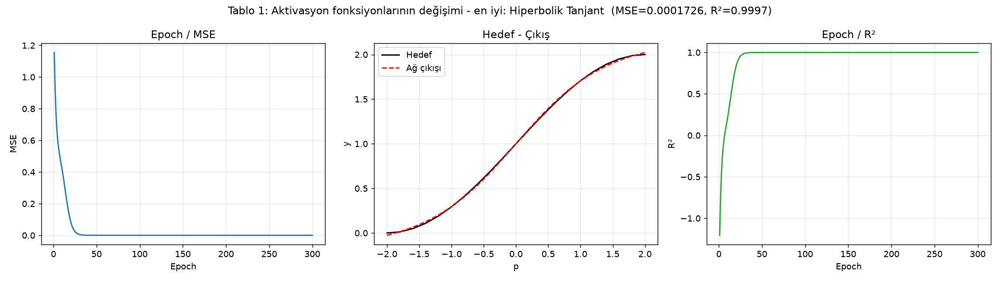

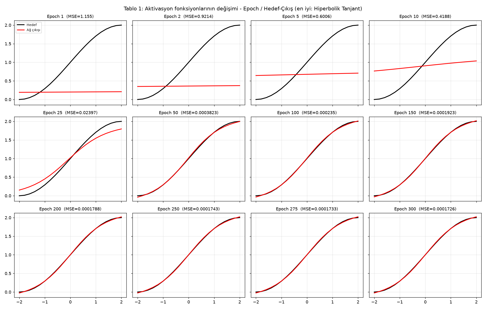

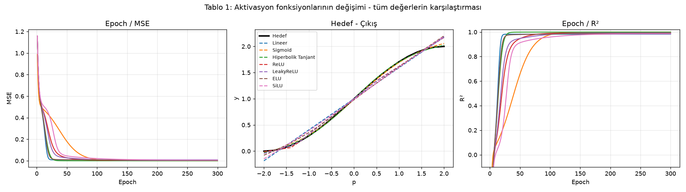

### Tablo 2. Öğrenme oranının değişimi

(Aktivasyon: tanh, Ayar Yöntemi: SGD, Olasılık dağılımı: normal, Gizli katman sayısı: 1, Gizli katmandaki nöron sayısı: 2)

| | MSE | R2 | Süre (sn) |
|---|---|---|---|
| **0.1** | **0.000172645** | **0.999670** | **2.95** |
| 0.01 | 0.00562711 | 0.989257 | 2.86 |
| 0.001 | 0.806196 | -0.539102 | 2.89 |

En iyi: **0.1**.

Öğrenme oranının değişimi ait yorumlar: _(öğrenci tarafından yazılacak)_

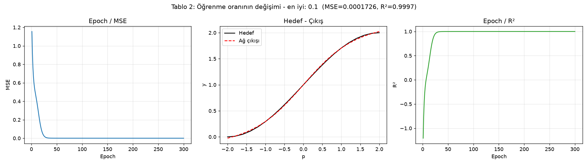

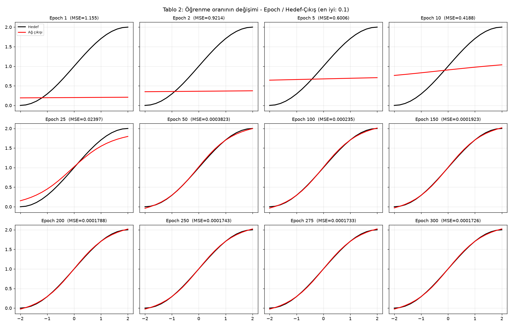

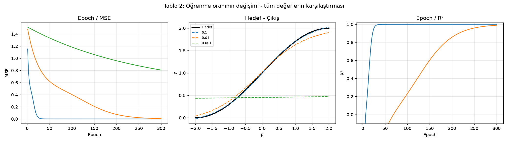

### Tablo 3. Öğrenme oranı ayar yönteminin değişimi

(Aktivasyon: tanh, Öğrenme Oranı: 0.1, Olasılık dağılımı: normal, Gizli katman sayısı: 1, Gizli katmandaki nöron sayısı: 2)

| | MSE | R2 | Süre (sn) |
|---|---|---|---|
| SGD | 0.000172645 | 0.999670 | 2.98 |
| RMSProp | 0.0138057 | 0.973644 | 2.99 |
| **Adam** | **0.000137348** | **0.999738** | **3.00** |

En iyi: **Adam**.

Öğrenme oranı ayar yönteminin değişimi ait yorumlar: _(öğrenci tarafından yazılacak)_

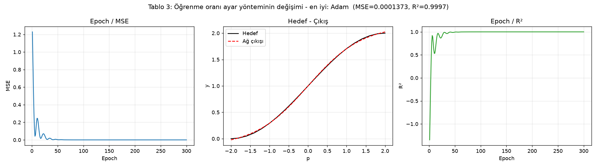

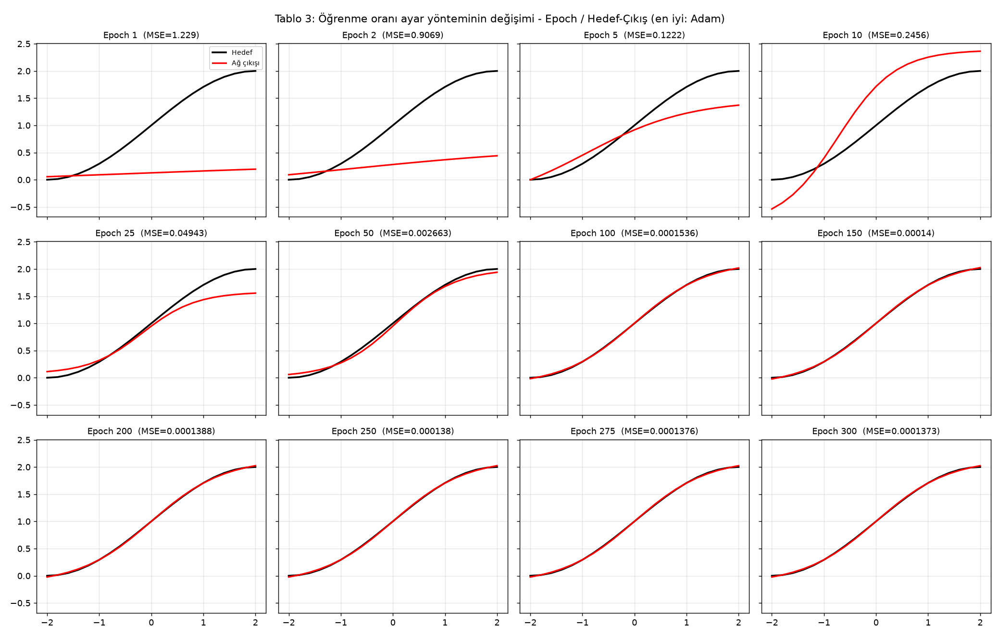

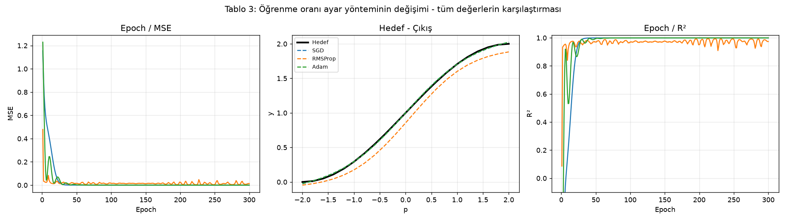

### Tablo 4. Ağırlık başlangıç değerlerinin olasılık dağılımının değişimi

(Aktivasyon: tanh, Öğrenme Oranı: 0.1, Ayar Yöntemi: Adam, Gizli katman sayısı: 1, Gizli katmandaki nöron sayısı: 2)

| | MSE | R2 | Süre (sn) |
|---|---|---|---|
| Normal | 0.000137348 | 0.999738 | 3.50 |
| **Uniform** | **0.00013692** | **0.999739** | **3.75** |

En iyi: **Uniform**.

Ağırlık başlangıç değerlerinin olasılık dağılımının değişimi ait yorumlar: _(öğrenci tarafından yazılacak)_

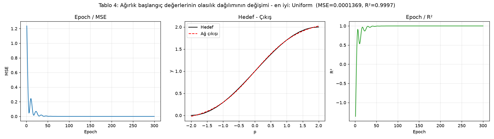

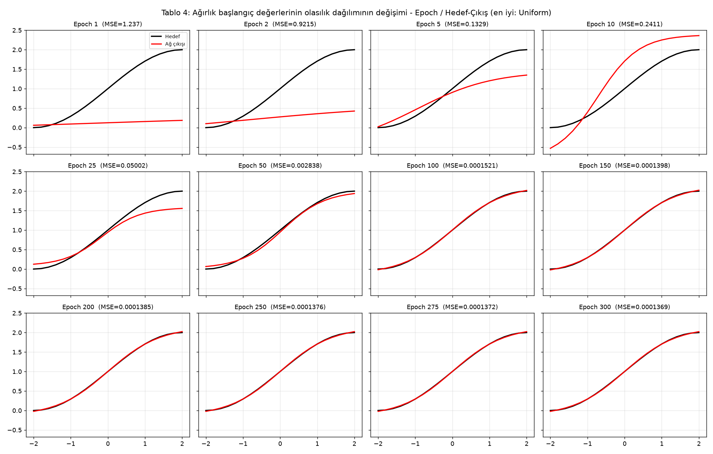

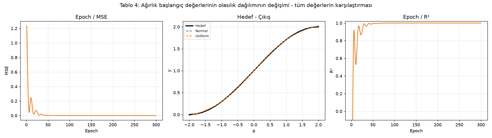

### Tablo 5. Gizli katman sayısının değişimi

(Aktivasyon: tanh, Öğrenme Oranı: 0.1, Ayar Yöntemi: Adam, Olasılık dağılımı: uniform, Gizli katmandaki nöron sayısı: 2)

| | MSE | R2 | Süre (sn) |
|---|---|---|---|
| 1 | 0.00013692 | 0.999739 | 3.34 |
| **2** | **0.0000392417** | **0.999925** | **3.24** |
| 5 | 0.108566 | 0.792737 | 3.53 |
| 10 | 0.131482 | 0.748989 | 4.32 |
| 20 | 0.52381 | 0.000000 | 5.48 |

En iyi: **2**.

Gizli katman sayısının değişimi ait yorumlar: _(öğrenci tarafından yazılacak)_

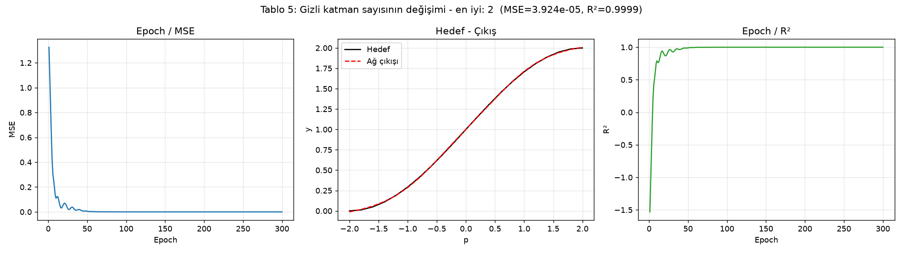

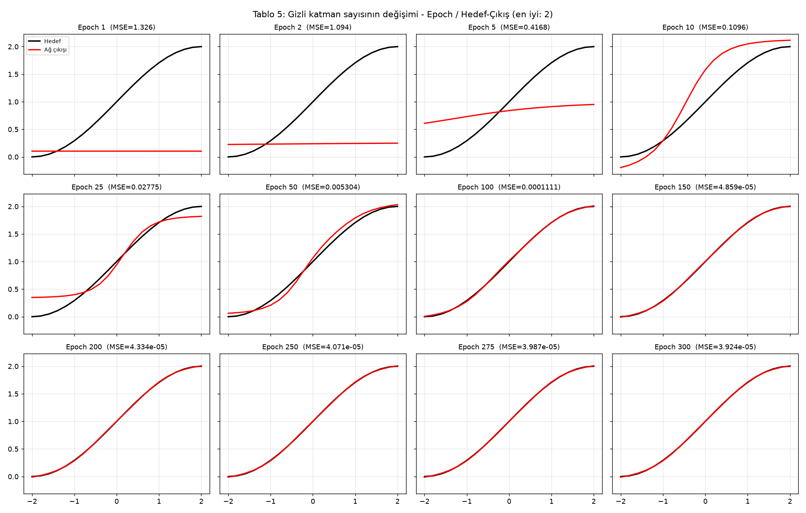

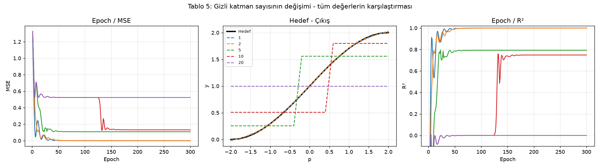

### Tablo 6. Gizli katmandaki nöron sayısının değişimi

(Aktivasyon: tanh, Öğrenme Oranı: 0.1, Ayar Yöntemi: Adam, Olasılık dağılımı: uniform, Gizli katman sayısı: 2)

| | MSE | R2 | Süre (sn) |
|---|---|---|---|
| 2 | 0.0000392417 | 0.999925 | 3.44 |
| 5 | 0.000117489 | 0.999776 | 3.46 |
| 10 | 0.0000597995 | 0.999886 | 3.33 |
| 20 | 0.000167376 | 0.999680 | 3.31 |
| **50** | **0.0000293996** | **0.999944** | **3.61** |

En iyi: **50**.

Gizli katmandaki nöron sayısının değişimi ait yorumlar: _(öğrenci tarafından yazılacak)_

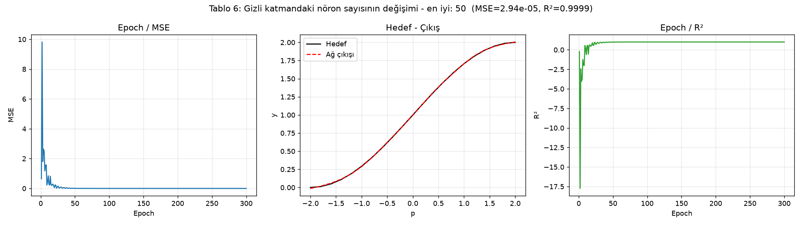

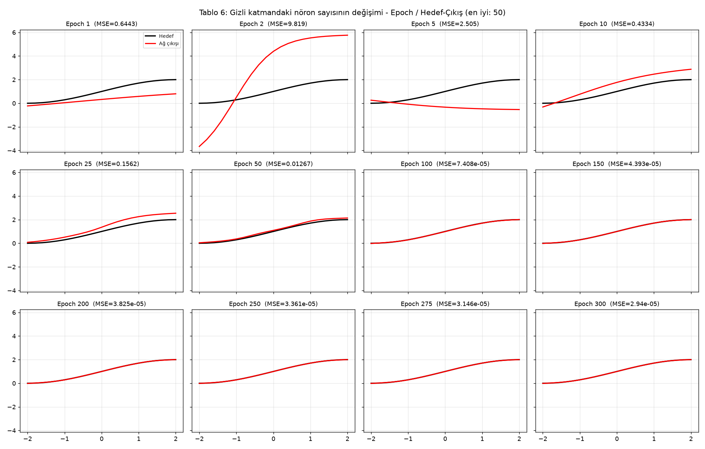

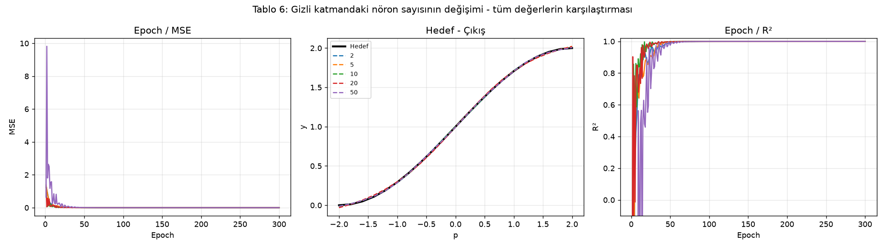

## Her tablonun en iyi değeri

- Aktivasyon fonksiyonlarının değişimi: Hiperbolik Tanjant
- Öğrenme oranının değişimi: 0.1
- Öğrenme oranı ayar yönteminin değişimi: Adam
- Ağırlık başlangıç değerlerinin olasılık dağılımının değişimi: Uniform
- Gizli katman sayısının değişimi: 2
- Gizli katmandaki nöron sayısının değişimi: 50

Bütün deneylere ait genel yorumlar: _(öğrenci tarafından yazılacak)_
